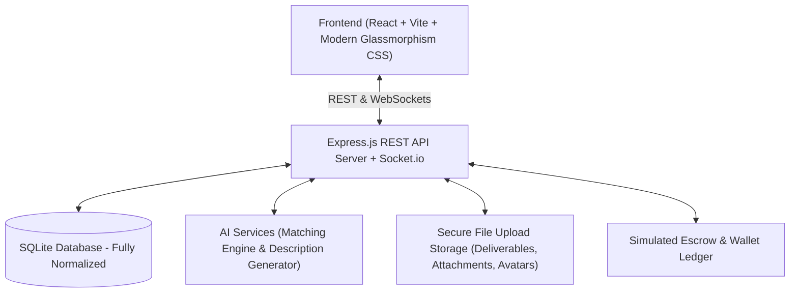

# Implementation Plan - Student Freelance Marketplace

A full-stack, state-of-the-art web platform empowering students to offer their skills, hire peers for freelance projects, collaborate in real-time, simulate secure escrow payments, build professional portfolios, and manage marketplace operations.

---

## 1. User Review Required

> [!IMPORTANT]
> - **Dual-Role Architecture**: Every student account can seamlessly toggle between **Freelancer** and **Client** modes without needing separate registrations.
> - **Payment Simulation**: Includes an interactive Escrow & Wallet system with balance top-up, escrow lock on project acceptance, automated release on project completion, refund on rejection, and transaction history.
> - **Built-in AI Modules**: Includes **AI Freelancer Recommender**, **AI Project Description Generator**, **AI Skill Matching Engine (with percentage match scores)**, and **AI Gig Optimizer**.
> - **Seed Data**: Pre-populated with realistic student profiles across Indian & Global colleges (Computer Science, Design, Media, Literature, Math), gigs, active projects, chats, and reviews to ensure immediate out-of-the-box demonstrability.

---

## 2. System Architecture & Tech Stack



### Technology Stack
- **Frontend**: React 18 / 19, Vite, Lucide React (icons), Pure CSS Design System with custom design tokens, modern glassmorphism, dark/light theme, responsive flex/grid layouts, micro-animations.
- **Backend**: Node.js, Express.js, Socket.io (real-time chat and instant notifications), Multer (file uploads & attachments), JSON Web Tokens (JWT) + bcryptjs (secure authentication and RBAC), CORS.
- **Database**: SQLite with parameterized SQL queries (clean relational schema, indexes, relational constraints, zero external database setup friction, portable and fast).
- **AI Engine**: Fast semantic keyword matching, heuristic TF-IDF and structured schema generators for project prompts, skill comparison, and recommendation scoring.

---

## 3. Database Schema (Entities & Relationships)

1. **`users`**: `id`, `name`, `email`, `password_hash`, `role` (`student`, `admin`), `college`, `department`, `year_of_study`, `avatar_url`, `bio`, `is_verified_student`, `is_suspended`, `created_at`
2. **`skills`**: `id`, `user_id`, `skill_name`, `proficiency_level` (`Beginner`, `Intermediate`, `Expert`)
3. **`categories`**: `id`, `name`, `slug`, `icon`, `description`, `created_at`
4. **`services`** (Gigs): `id`, `user_id` (freelancer), `category_id`, `title`, `description`, `starting_price`, `delivery_days`, `skills_csv`, `cover_image`, `is_active`, `rating_avg`, `review_count`, `created_at`
5. **`portfolio_items`**: `id`, `user_id`, `title`, `description`, `project_url`, `image_url`, `skills_csv`, `created_at`
6. **`projects`** (Orders): `id`, `service_id` (nullable for custom request), `client_id`, `freelancer_id`, `title`, `description`, `requirements`, `budget`, `deadline_date`, `status` (`REQUESTED`, `ACCEPTED`, `IN_PROGRESS`, `SUBMITTED`, `REVISION`, `COMPLETED`, `CANCELLED`), `escrow_funded`, `submission_notes`, `submission_file_url`, `created_at`, `updated_at`
7. **`messages`**: `id`, `project_id`, `sender_id`, `receiver_id`, `content`, `attachment_url`, `attachment_name`, `is_read`, `created_at`
8. **`wallets`**: `id`, `user_id`, `balance`, `escrow_balance`, `total_earned`, `total_spent`, `updated_at`
9. **`transactions`**: `id`, `user_id`, `project_id`, `amount`, `type` (`TOPUP`, `ESCROW_LOCK`, `ESCROW_RELEASE`, `REFUND`, `WITHDRAW`), `status`, `reference_id`, `created_at`
10. **`reviews`**: `id`, `project_id`, `reviewer_id`, `reviewee_id`, `overall_rating`, `communication_rating`, `quality_rating`, `timeliness_rating`, `comment`, `created_at`
11. **`notifications`**: `id`, `user_id`, `type`, `title`, `message`, `link_url`, `is_read`, `created_at`
12. **`reports`**: `id`, `reporter_id`, `target_type` (`user`, `service`, `review`, `message`, `project`), `target_id`, `reason`, `details`, `status` (`PENDING`, `RESOLVED`, `DISMISSED`), `admin_notes`, `created_at`

---

## 4. Key Workflows & Features

### 4.1 Complete Project Lifecycle
```
[Client submits Project Request]
             ↓
[Freelancer accepts & sets to IN_PROGRESS (Escrow funds locked)]
             ↓
[Real-time Chat, File Exchange & AI Assistance]
             ↓
[Freelancer Submits Deliverable Files & Notes]
             ↓
[Client Reviews: Request Revision OR Approve & Complete]
             ↓
[Approval -> Escrow Released to Freelancer Wallet -> Rating/Review modal -> Portfolio Auto-sync]
```

### 4.2 Search, Filter & AI Discovery
- Real-time search query across service titles, freelancer names, skills, and bio.
- Filters: Category pills, Price slider (₹0 - ₹20,000+), Rating (4.5+, 4.0+, 3.0+), Delivery time (1 day, 2-3 days, 1 week), College filter.
- **AI Recommendation Tab**: Client can describe a project in plain English, and the AI engine ranks top matching student freelancers with compatibility scores.
- **AI Project Description Generator**: Button on the project request form that expands a one-liner into detailed requirements, deliverables, milestones, and tech stack.

### 4.3 Dual Freelancer / Client Dashboards
- **Freelancer Dashboard**: Active gigs, project request pipeline, pending submissions, earnings analytics, ratings breakdown, portfolio showcase editor.
- **Client Dashboard**: Projects posted/hired, live status milestones, total spent, freelancer directory, review history.
- **Admin Dashboard**: System metrics, user verification status badges, category management (add/edit/delete), service moderation, transaction ledger, report review & action center (ban/warn/dismiss).

### 4.4 Real-Time Chat & File Uploads
- WebSocket-powered chat with real-time typing indicators, unread counters, quick attachments (PDF, DOCX, ZIP, PPT, images), and embedded deliverable previews.
- Instant in-app notification toasts for new messages and status transitions.

---

## 5. Implementation Steps

### Phase 1: Project Setup & Backend Architecture
- [NEW] `backend/package.json`: Express, SQLite3, Socket.io, Multer, bcryptjs, jsonwebtoken, cors.
- [NEW] `backend/src/db/database.js`: SQLite schema initialization with relational tables, foreign keys, triggers, and indices.
- [NEW] `backend/src/db/seed.js`: Comprehensive seed data with 6+ realistic student profiles, portfolio items, diverse services, active projects, messages, wallets, reviews, and admin account.
- [NEW] `backend/src/middleware/auth.js`: JWT token verification, RBAC (student/admin), and ownership checks.
- [NEW] `backend/src/routes/`:
  - `authRoutes.js`: Login, register, demo login switcher, profile details, college verification.
  - `userRoutes.js`: Student profiles, portfolio management, skills, stats.
  - `serviceRoutes.js`: Gigs CRUD, categories, search, filtering, sorting.
  - `projectRoutes.js`: Project request creation, lifecycle transitions (accept, start, submit, revision, approve, cancel).
  - `chatRoutes.js`: Chat history, message dispatch, file upload attachments.
  - `walletRoutes.js`: Wallet balance, escrow simulation, transaction log, top-up.
  - `reviewRoutes.js`: Multi-criteria rating submission and aggregation.
  - `notificationRoutes.js`: Notification list, mark as read, real-time push.
  - `adminRoutes.js`: Admin statistics, student verification, category management, report resolution, user moderation.
  - `aiRoutes.js`: AI Freelancer matching, AI project description generator, AI gig copy assistant.
- [NEW] `backend/src/server.js`: HTTP + WebSocket server integrating all routes and upload handlers.

### Phase 2: Frontend Setup & Design System
- [NEW] `frontend/package.json`: React, Vite, Lucide-React, Canvas-Confetti (for project completion celebrations).
- [NEW] `frontend/src/index.css`: Modern design tokens, vibrant gradients (Indigo/Violet/Emerald), glassmorphism, card shadows, responsive layout utilities, dark/light theme variables.
- [NEW] `frontend/src/context/`:
  - `AuthContext.jsx`: User state, login, register, role toggling, demo switcher.
  - `SocketContext.jsx`: Real-time WebSocket connection, notifications listener, chat listener.
  - `ThemeContext.jsx`: Dark/Light mode switcher.
- [NEW] `frontend/src/components/`:
  - Navigation Navbar with active role badge, wallet balance pill, notification dropdown, search bar, theme toggle, and profile avatar.
  - Quick Demo Account Switcher modal (Instant 1-click login as Freelancer, Client, or Admin).
  - ServiceCard, FreelancerCard, StatusBadge, StarRating, CategoryPills.
  - AI Assistant Modal & Floating Widget (Project description generator & matching analyzer).
  - PaymentModal (Simulated escrow checkout with UPI/Card options).
  - ReviewModal (Multi-criteria rating with stars for Quality, Communication, Timeliness).
  - ReportModal (Report user/service/message with reason).
  - ChatDrawer / ChatView (Real-time conversation with file upload and deliverable previews).

### Phase 3: Application Pages & Views
- [NEW] `frontend/src/pages/`:
  - `Home.jsx`: Hero with search, popular categories, featured student freelancers, trending services, platform statistics, how-it-works workflow guide.
  - `ExploreServices.jsx`: Full search & discovery with multi-faceted filters, sorting, category sidebar, and AI match recommendation tab.
  - `ServiceDetail.jsx`: Gig overview, pricing tiers, delivery time, freelancer card, portfolio previews, reviews list, and "Hire Student / Request Project" modal.
  - `FreelancerProfile.jsx`: Profile header (college, dept, year, verification badge), skills tags, bio, portfolio gallery, active gigs, client reviews with breakdown.
  - `ProjectDetail.jsx`: Complete project tracking workstation (lifecycle stepper, requirements, deliverables, live chat window, payment escrow status, action buttons for Freelancer & Client, review submission).
  - `DashboardFreelancer.jsx`: Freelancer command center (earnings, project orders, gig management, incoming requests, active jobs, portfolio editor).
  - `DashboardClient.jsx`: Client command center (hired projects, spending overview, pending requests, saved freelancers, AI recommendation shortcut).
  - `AdminDashboard.jsx`: Analytics charts, student verification manager, category editor, service moderation, reports center, user access controls.
  - `WalletPage.jsx`: Balance cards, escrow holds, add funds simulation, transaction history table.
  - `AuthPages.jsx`: Register, Login, Forgot Password with college email verification notice.

### Phase 4: Integration, Testing & Verification
- End-to-end testing of complete user journey:
  1. Login as Client -> Search for Graphic Design or Web Dev -> Try AI Project Recommender.
  2. Request a project with requirements & budget -> Switch to Freelancer view.
  3. Freelancer receives notification -> Accepts project (Escrow locked) -> Sends chat messages & files.
  4. Freelancer submits deliverable -> Client receives submission -> Client approves -> Escrow released to Freelancer wallet.
  5. Client leaves 5-star multi-criteria review -> Freelancer rating & completed projects count updated.
  6. Switch to Admin view -> Verify student accounts, view financial metrics, test report resolution.

---

## 6. Verification Plan

### Automated & API Verification
- Backend integration tests verifying:
  - Auth registration & JWT login.
  - Service creation & category assignment.
  - Project creation, state transitions, escrow ledger debit/credit consistency.
  - AI recommendation endpoint response quality & scoring.
  - Review calculation and aggregate score updates.

### Manual Verification via Browser Subagent
- Launch the application dev server.
- Run interactive browser subagent tests:
  - Navigate Home, Explore, and Profile pages.
  - Execute a full project cycle: Client Request -> Freelancer Accept -> Real-time Chat -> Submission -> Client Approval -> Rating & Review.
  - Verify Admin dashboard charts, moderation tools, and verification controls.
  - Capture visual screenshots of the interface.
