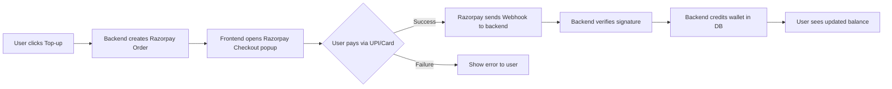

# 💳 Payment Integration Guide — CampusGig

## Current State

Right now the wallet is **simulated** — clicking "Top-up" just adds money directly to the DB without any real payment. The goal is to replace this with **real Razorpay payments**.

> [!NOTE]
> **Razorpay** is the best choice for India. It supports UPI, Cards, Net Banking, Wallets — and has a free test mode. No monthly fees, only 2% per transaction.

---

## What You Need to Change



---

## Step 1 — Create Razorpay Account

1. Go to **[https://razorpay.com](https://razorpay.com)** → Sign Up (free)
2. Dashboard → **Settings → API Keys → Generate Test Key**
3. Copy your `Key ID` and `Key Secret`

---

## Step 2 — Install Razorpay on Backend

```bash
cd backend
npm install razorpay
```

---

## Step 3 — Add Keys to `.env`

Add these to [`backend/.env`](file:///d:/student-freelance-marketplace/backend/.env):

```env
RAZORPAY_KEY_ID=rzp_test_XXXXXXXXXXXXXXXXXX
RAZORPAY_KEY_SECRET=XXXXXXXXXXXXXXXXXXXXXXXX
```

---

## Step 4 — Update Backend [`walletRoutes.js`](file:///d:/student-freelance-marketplace/backend/src/routes/walletRoutes.js)

Replace the simulated `/topup` with two new routes:

### Route 1: Create Razorpay Order
`POST /api/wallet/create-order` — called first, before payment

### Route 2: Verify Payment & Credit Wallet
`POST /api/wallet/verify-payment` — called after Razorpay success

```js
import express from 'express';
import Razorpay from 'razorpay';
import crypto from 'crypto';
import db from '../db/database.js';
import { authenticateToken } from '../middleware/auth.js';

const router = express.Router();

const razorpay = new Razorpay({
  key_id: process.env.RAZORPAY_KEY_ID,
  key_secret: process.env.RAZORPAY_KEY_SECRET,
});

// GET wallet balance
router.get('/', authenticateToken, (req, res) => {
  const wallet = db.getWallet(req.user.id);
  return res.json({ success: true, wallet });
});

// Step 1: Create Razorpay order (returns order_id for frontend)
router.post('/create-order', authenticateToken, async (req, res) => {
  try {
    const { amount } = req.body;            // amount in ₹ (e.g. 500)
    const numAmount = Number(amount);
    if (!numAmount || numAmount < 1 || numAmount > 50000) {
      return res.status(400).json({ success: false, message: 'Invalid amount (₹1 – ₹50,000)' });
    }

    const order = await razorpay.orders.create({
      amount: numAmount * 100,              // Razorpay needs paise (multiply by 100)
      currency: 'INR',
      receipt: `wallet_${req.user.id}_${Date.now()}`,
    });

    return res.json({ success: true, order, key: process.env.RAZORPAY_KEY_ID });
  } catch (err) {
    console.error('Razorpay order error:', err);
    return res.status(500).json({ success: false, message: 'Could not create payment order' });
  }
});

// Step 2: Verify Razorpay payment signature and credit wallet
router.post('/verify-payment', authenticateToken, (req, res) => {
  try {
    const { razorpay_order_id, razorpay_payment_id, razorpay_signature, amount } = req.body;

    // Verify signature (HMAC-SHA256)
    const body = razorpay_order_id + '|' + razorpay_payment_id;
    const expectedSig = crypto
      .createHmac('sha256', process.env.RAZORPAY_KEY_SECRET)
      .update(body)
      .digest('hex');

    if (expectedSig !== razorpay_signature) {
      return res.status(400).json({ success: false, message: 'Payment verification failed — invalid signature' });
    }

    // Signature valid — credit the wallet
    const numAmount = Number(amount);
    const wallet = db.topupWallet(req.user.id, numAmount);

    db.createNotification({
      user_id: req.user.id,
      type: 'WALLET_TOPUP',
      title: 'Wallet Recharged! 💳',
      message: `₹${numAmount} credited via Razorpay (${razorpay_payment_id})`,
      link_url: '/wallet'
    });

    return res.json({ success: true, message: `₹${numAmount} added to wallet!`, wallet });
  } catch (err) {
    console.error('Payment verify error:', err);
    return res.status(500).json({ success: false, message: 'Verification failed' });
  }
});

export default router;
```

---

## Step 5 — Add Razorpay Script to Frontend

Add this to [`frontend/index.html`](file:///d:/student-freelance-marketplace/frontend/index.html) inside `<head>`:

```html
<script src="https://checkout.razorpay.com/v1/checkout.js"></script>
```

---

## Step 6 — Update [`WalletPage.jsx`](file:///d:/student-freelance-marketplace/frontend/src/pages/WalletPage.jsx)

Replace the `handleTopup` function:

```jsx
const handleTopup = async (e) => {
  e.preventDefault();
  setProcessing(true);

  try {
    // Step 1: Create order on backend
    const orderRes = await fetch('/api/wallet/create-order', {
      method: 'POST',
      headers: {
        'Content-Type': 'application/json',
        Authorization: `Bearer ${localStorage.getItem('campusgig_token')}`
      },
      body: JSON.stringify({ amount: Number(topupAmount) })
    });
    const orderData = await orderRes.json();
    if (!orderData.success) {
      alert(orderData.message);
      setProcessing(false);
      return;
    }

    // Step 2: Open Razorpay Checkout popup
    const options = {
      key: orderData.key,
      amount: orderData.order.amount,         // in paise
      currency: 'INR',
      name: 'CampusGig',
      description: 'Wallet Top-up',
      order_id: orderData.order.id,
      handler: async (response) => {
        // Step 3: Verify payment on backend
        const verifyRes = await fetch('/api/wallet/verify-payment', {
          method: 'POST',
          headers: {
            'Content-Type': 'application/json',
            Authorization: `Bearer ${localStorage.getItem('campusgig_token')}`
          },
          body: JSON.stringify({
            razorpay_order_id: response.razorpay_order_id,
            razorpay_payment_id: response.razorpay_payment_id,
            razorpay_signature: response.razorpay_signature,
            amount: Number(topupAmount)
          })
        });
        const verifyData = await verifyRes.json();
        if (verifyData.success) {
          setWallet(verifyData.wallet);
          refreshUser();
          setShowTopupModal(false);
          alert('✅ Wallet recharged successfully!');
        } else {
          alert('Payment failed: ' + verifyData.message);
        }
        setProcessing(false);
      },
      prefill: {
        name: user?.name || '',
        email: user?.email || '',
      },
      theme: { color: '#0A5FD6' },
      modal: {
        ondismiss: () => setProcessing(false)
      }
    };

    const rzp = new window.Razorpay(options);
    rzp.open();

  } catch (err) {
    alert('Error: ' + err.message);
    setProcessing(false);
  }
};
```

---

## Test Mode vs Live Mode

| Mode | Key prefix | Real money? |
|------|------------|-------------|
| **Test** | `rzp_test_...` | ❌ No — use test cards |
| **Live** | `rzp_live_...` | ✅ Yes — real payments |

### Test Cards (use these while developing)
| Card Number | Expiry | CVV | Result |
|-------------|--------|-----|--------|
| `4111 1111 1111 1111` | Any future | Any | ✅ Success |
| `5267 3181 8797 5449` | Any future | Any | ✅ Success |

### Test UPI
- UPI ID: `success@razorpay` → Payment succeeds
- UPI ID: `failure@razorpay` → Payment fails

---

## Summary of Files to Change

| File | Change |
|------|--------|
| `backend/.env` | Add `RAZORPAY_KEY_ID` and `RAZORPAY_KEY_SECRET` |
| `backend/src/routes/walletRoutes.js` | Replace `/topup` with `/create-order` + `/verify-payment` |
| `frontend/index.html` | Add Razorpay checkout script tag |
| `frontend/src/pages/WalletPage.jsx` | Replace `handleTopup` with Razorpay flow |

> [!IMPORTANT]
> The signature verification in Step 2 is **critical for security**. Never skip it — it prevents users from faking successful payments.

> [!TIP]
> Once you're ready for real payments, just swap `rzp_test_` keys with `rzp_live_` keys — no code changes needed.
